# 🌟 Awesome AI Agent Observability & Code Monitoring

  

  
  
  
  
  
  

---

## 🎯 Top AI Agent Observability & Code Monitoring Ecosystem

**Curated List of SaaS Products & Open-Source GitHub Projects for Autonomous Agents & LLMOps**  
*Focused on OpenTelemetry Agent Tracing, Coding Agent Session Monitors (Claude Code, Cursor, OpenHands), LLM Cost/Token Telemetry, Trajectory Debugging, Guardrails & Evaluation.*

📅 **Last updated: November 2026**

This repository tracks notable **SaaS platforms** and **open-source repositories** for **AI Agent Observability, Telemetry & Code Monitoring**. These tools capture span-level traces across multi-step autonomous agent runs, monitor autonomous coding agents (`Claude Code`, `Codex`, `Cursor`, `OpenHands`, `Devin`) in real time, track token burn and API latencies, and evaluate agentic trajectory reliability in production CI/CD pipelines.

---

## 📑 Table of Contents

- [📊 Sector Overview & Market Dynamics](#-sector-overview--market-dynamics)
- [☁️ SaaS/Hosted Platforms](#️-saashosted-platforms)
- [💻 Open-Source GitHub Projects](#-open-source-github-projects)
- [🤝 How to Contribute](#-how-to-contribute)
- [💖 Support & Community](#-support--community)
- [📈 Star History](#-star-history)
- [⚖️ Disclaimer](#️-disclaimer)

---

## 📊 Sector Overview & Market Dynamics

The AI Agent & LLM Observability market is valued at approximately **$2.7B to $3.5B in 2026** and is accelerating at a rapid **~30–36% CAGR**, projected to exceed **$9.3B by 2030**. 

The sector is currently transitioning from **high fragmentation** (characterized by an explosion of niche prompt logging and evaluation startups) toward **moderate concentration**, driven by aggressive M&A consolidation from legacy enterprise APM giants (e.g., Dynatrace acquiring Arize, CoreWeave acquiring Weights & Biases, ServiceNow acquiring Traceloop, and ClickHouse acquiring Langfuse) alongside dominant open-source telemetry standards centered around OpenTelemetry.

---

## ☁️ SaaS/Hosted Platforms

| 🏢 Platform | 💰 Company Valuation / Revenue | 🏷️ Starting Paid Tier Price | 🎁 Free Tier Limits / Trial | 📝 Description |
| :--- | :--- | :--- | :--- | :--- |
| **[LangSmith (LangChain)](https://langchain.com)** | **$3.0B valuation** (Series C) / ~$16M ARR | **$39 / user / month** (Plus Plan; includes 10,000 traces/mo, additional at $2.50/1k) | **Developer Free Plan**: 5,000 traces/mo, 1 seat, 14-day data retention | All-in-one cloud observability, debugging, testing, and evaluation platform engineered for tracing complex LLM chains and stateful LangGraph agent runs. |
| **[Weights & Biases Weave](https://wandb.ai)** | **$1.4B–$1.7B acquisition** by CoreWeave / ~$50M ARR | **$60 / month** (Pro Plan; up to 10 seats, 100 GB storage) | **Free Plan**: Up to 5 model seats, ~1 GB/mo Weave trace ingestion, 5 GB storage | Cloud developer toolkit from W&B for logging, tracing, visualizing, and evaluating LLM calls, tool executions, and multi-agent workflows. |
| **[Arize AX / Arize Phoenix Cloud](https://arize.com)** | **$915M acquisition** by Dynatrace (raised $131M) | **$50 / month** (AX Pro; 50,000 spans/mo, 10 GB ingestion, 30-day retention) | **Free Plan**: 25,000 spans/mo, 1 GB ingestion, 15-day data retention, 1 space | Enterprise AI observability and LLM evaluation platform delivering deep OpenTelemetry span tracing, drift detection, and root-cause diagnostics for agents. |
| **[Braintrust](https://braintrust.dev)** | **$800M valuation** (Series B) | **$249 / month** (Pro Plan; includes 5 GB processed data, 50k scores/mo, $100 model credits) | **Starter Free Plan**: 1 GB processed data/mo, 10,000 scores/mo, 14-day retention, $10 model credits/mo | Enterprise AI evaluation, prompt playground, and logging platform designed to score multi-step agent trajectories and prevent quality regressions. |
| **[Galileo](https://rungalileo.io)** | **$100M–$250M estimated valuation** ($68M raised) / ~$5M ARR | **$100 / month** (billed annually, or $150/mo billed monthly; Pro Plan includes 50,000 traces/mo) | **Free Plan**: 5,000 traces/mo, single-user access, unlimited custom evaluations | Enterprise AI evaluation and observability platform featuring real-time hallucination guardrails, agentic trajectory metrics, and automated error clustering. |
| **[Traceloop](https://traceloop.com)** | **$70M acquisition** by ServiceNow ($6.6M raised) | **Custom annual enterprise contract** (starts ~$15,000/yr via AWS/cloud marketplace) | **Free Plan**: 50,000 spans/mo, up to 5 seats, 24-hour data retention | Managed OpenTelemetry-native LLM observability and reliability platform built on OpenLLMetry for real-time agent tracing and hallucination detection. |
| **[HoneyHive](https://honeyhive.ai)** | **$7.4M funding raised** (Seed led by Insight Partners) | **Custom enterprise contract** (Sales-led; no intermediate self-serve tier) | **Developer Free Plan**: 10,000 events/mo, up to 5 users, 1 workspace, 30-day data retention | AI observability and evaluation suite built for compounding agent reliability via production trace curation, human feedback loops, and CI/CD regression checks. |
| **[Helicone](https://helicone.ai)** | **~$1M ARR** (YC-backed; acquisition by Mintlify) | **$79 / month** (Pro Plan; 1,000 logs/min, 1 month retention; includes 7-day free trial) | **Hobby Free Plan**: 10,000 requests/mo, 1 GB storage, 1 seat, 7-day data retention, 10 logs/min | Proxy-based LLM observability and AI gateway platform offering real-time request logging, token/cost analytics, caching, and rate-limit monitoring. |
| **[Lunary](https://lunary.ai)** | **Early-stage / Seed** (Xpreneurs backed) | **$20 / user / month** (Team Plan; includes 50,000 events/mo, 300 playground queries/mo) | **No free tier or trial on Cloud** (Requires $20/user/mo upfront; unlimited free usage if self-hosted via OSS) | Production LLM observability, prompt management, and user analytics platform tailored for multi-step AI agent workflows and B2B AI products. |
| **[OpenLIT Cloud](https://openlit.io)** | **Bootstrapped / Community open-source** | **Custom enterprise contract** (Managed cloud platform waitlist / Private beta) | **Waitlist only for Cloud** (Unlimited free usage with no trace caps or seat limits via self-hosted Apache 2.0 OSS) | Hosted OpenTelemetry-native observability and GPU/LLM monitoring platform tracking token consumption, vector database latency, and agent execution spans. |

---

## 💻 Open-Source GitHub Projects

All open-source repositories below are sorted in descending order by their GitHub Stars_Count. Each repo is paired with a direct social Stars_Badge linking to its stargazers page.

1. **[Langfuse (`langfuse/langfuse`)](https://github.com/langfuse/langfuse)**   
   Leading open-source LLM engineering and observability platform for full-stack agent tracing, nested span visualization, prompt versioning, session replays, and automated LLM-as-a-judge evaluations.

2. **[SigNoz (`SigNoz/signoz`)](https://github.com/SigNoz/signoz)**   
   Open-source alternative to DataDog and New Relic providing native OpenTelemetry distributed tracing, metrics, and log aggregation tailored for microservices and AI agent workloads.

3. **[MLflow (`mlflow/mlflow`)](https://github.com/mlflow/mlflow)**   
   Comprehensive open-source machine learning and LLMOps platform featuring native GenAI tracing, model evaluation, artifact tracking, and OpenTelemetry span visualization for agent pipelines.

4. **[Promptfoo (`promptfoo/promptfoo`)](https://github.com/promptfoo/promptfoo)**   
   Test-driven security, red-teaming, and CI/CD evaluation framework for LLMs and autonomous agents to detect hallucinations, assess tool-call correctness, and enforce safety guardrails.

5. **[Opik (`comet-ml/opik`)](https://github.com/comet-ml/opik)**   
   Open-source (`Apache-2.0`) end-to-end LLM evaluation and observability platform from Comet built for logging high-volume multi-agent runs, tracking token spend, and running automated judges.

6. **[Jaeger (`jaegertracing/jaeger`)](https://github.com/jaegertracing/jaeger)**   
   Cloud Native Computing Foundation (CNCF) graduated distributed tracing system used as a battle-tested backend for visualizing OpenTelemetry spans and multi-agent execution graphs.

7. **[DeepEval (`confident-ai/deepeval`)](https://github.com/confident-ai/deepeval)**   
   Open-source evaluation framework for unit testing LLM applications and agent trajectories with support for G-Eval, hallucination detection, RAG metrics, and tool execution accuracy.

8. **[ccusage (`ryoppippi/ccusage`)](https://github.com/ryoppippi/ccusage)**   
   Fast open-source CLI analyzer and terminal dashboard for parsing local Claude Code JSONL session logs, daily token burn, cache hit efficiency, and model API cost analytics.

9. **[Arize Phoenix (`Arize-ai/phoenix`)](https://github.com/Arize-ai/phoenix)**   
   Open-source AI observability and evaluation platform delivering interactive trace waterfall timelines, tool-calling diagnostics, RAG analysis, and notebook integration.

10. **[TensorZero (`tensorzero/tensorzero`)](https://github.com/tensorzero/tensorzero)**   
    High-performance, industrial-grade open-source LLM gateway, observability proxy, and experimentation engine written in Rust for low-latency agent telemetry.

11. **[OpenTelemetry Collector (`open-telemetry/opentelemetry-collector`)](https://github.com/open-telemetry/opentelemetry-collector)**   
    The vendor-agnostic proxy and telemetry receiver for ingesting, processing, filtering, and routing agent traces and span metrics to any observability backend.

12. **[OpenLLMetry (`traceloop/openllmetry`)](https://github.com/traceloop/openllmetry)**   
    Open-source OpenTelemetry extensions that enable zero-code auto-instrumentation and standardized semantic spans for major LLM providers, agent frameworks (LangChain, CrewAI, AutoGen), and vector databases.

13. **[Helicone (`Helicone/helicone`)](https://github.com/Helicone/helicone)**   
    Open-source AI developer gateway providing real-time request logging, token spend monitoring, latency analytics, semantic caching, and prompt experiment management.

14. **[AgentOps SDK (`AgentOps-AI/agentops`)](https://github.com/AgentOps-AI/agentops)**   
    Open-source Python SDK for AI agent monitoring featuring execution session replays, tool-usage failure tracking, cost accounting, and integrations with CrewAI, LangChain, and AutoGen.

15. **[LangWatch (`langwatch/langwatch`)](https://github.com/langwatch/langwatch)**   
    Self-hostable LLM Ops and agent monitoring platform featuring real-time hallucination guardrails, OpenTelemetry support, cost analytics, and visual trace debugging.

16. **[Agenta (`Agenta-AI/agenta`)](https://github.com/Agenta-AI/agenta)**   
    Open-source LLMOps developer platform for prompt engineering, collaborative playground evaluations, human annotation workflows, and multi-step agent trajectory testing.

17. **[Logfire (`pydantic/logfire`)](https://github.com/pydantic/logfire)**   
    OpenTelemetry-native observability platform and SDK from the Pydantic team offering first-class Python tracing for Pydantic AI, FastAPI, OpenAI, and agent workflows.

18. **[Inspect AI (`UKGovernmentBEIS/inspect_ai`)](https://github.com/UKGovernmentBEIS/inspect_ai)**   
    Open-source evaluation framework from the UK AI Safety Institute (AISI) for inspecting, benchmarking, and scoring complex coding agent workflows with transcript timeline viewers.

19. **[OpenLIT (`openlit/openlit`)](https://github.com/openlit/openlit)**   
    Open-source OpenTelemetry-native AI engineering platform providing auto-instrumentation for 50+ LLMs, agent frameworks, vector databases, and GPU infrastructure metrics.

20. **[Claude Code Hooks Observability (`disler/claude-code-hooks-multi-agent-observability`)](https://github.com/disler/claude-code-hooks-multi-agent-observability)**   
    Live dashboard streaming real-time multi-agent Claude Code telemetry via lifecycle hooks (`PreToolUse`, `PostToolUse`, `SubagentStop`) to inspect tool runs and sub-agent handoffs.

21. **[OpenInference (`Arize-ai/openinference`)](https://github.com/Arize-ai/openinference)**   
    Standardized OpenTelemetry semantic conventions and instrumentation libraries for tracing AI agent workflows, retrieval steps, and tool invocations across Python, TypeScript, and Java.

22. **[Claude Code Agent Monitor (`hoangsonww/Claude-Code-Agent-Monitor`)](https://github.com/hoangsonww/Claude-Code-Agent-Monitor)**   
    Open-source real-time telemetry dashboard designed specifically for inspecting local Claude Code agent sessions, sub-agent cascades, file modifications, token consumption, and execution timelines.

23. **[Weights & Biases Weave (`wandb/weave`)](https://github.com/wandb/weave)**   
    Lightweight open-source toolkit for tracking function calls, tool executions, and evaluation metrics across LLM applications and autonomous agents.

---

## 🤝 How to Contribute

Contributions are warmly welcomed! Help make this curated list the most comprehensive resource for AI Agent observability and code monitoring:

1. **Fork** this repository.
2. **Create a branch**: `git checkout -b add-my-tool`.
3. **Add or update** entries in `README.md` maintaining alphabetical order or the relevant table/star rankings.
4. **Include**: Product name, official link, 1–2 sentence factual summary, pricing/tier details (for SaaS), or repo Stars_Badge (for OSS).
5. **Submit a Pull Request** with a brief overview of the tool added.

---

## 💖 Support & Community

If you find this repository valuable for your AI agent engineering, LLMOps architecture, or coding workflow telemetry:

- ⭐ **Star this repository** to show your support and stay updated!
- 🍴 **Fork and share** it with your engineering team and community.
- 💬 **Join our community on Discord**: [Join Discord](https://discord.gg/jc4xtF58Ve)
- ☕ **Support the maintainer**: Buy a coffee or become a sponsor on the [GitHub Sponsor Dashboard](https://github.com/sponsors/ishandutta2007) to help sustain open-source curation and tooling research!

---

## 📈 Star History

---

## ⚖️ Disclaimer

*All trademarks, logos, brand names, and product names referenced in this repository belong to their respective owners. Mention of SaaS products or open-source projects is purely informational and educational, and does not constitute official endorsement. Pricing tiers, limits, and Stars_Counts are subject to change by their respective providers and maintainers.*
